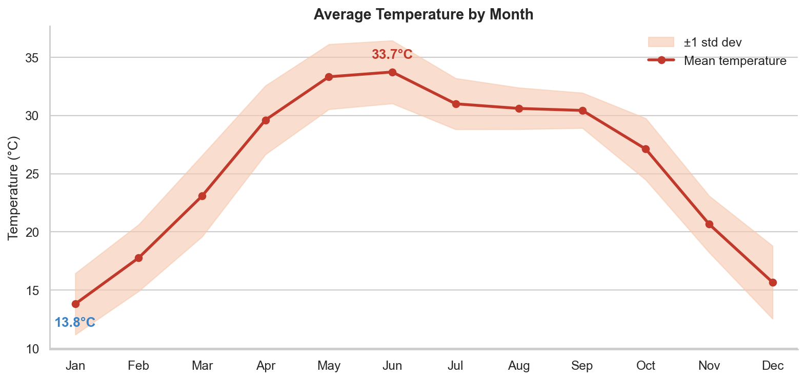
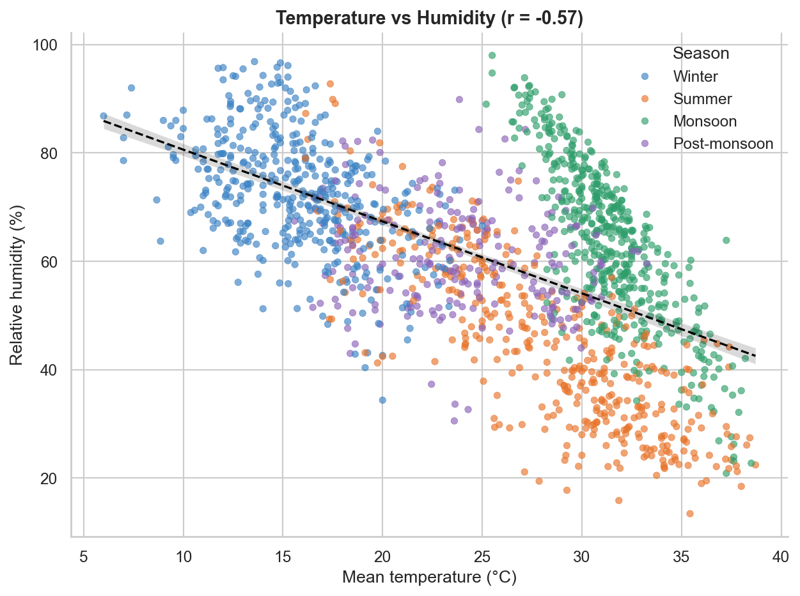

# Weather Data Analysis

Python project that cleans a real daily weather dataset for **Delhi, India (2013-01-01 to 2017-04-24)** and analyses temperature, humidity, wind, pressure and seasonal trends with **Pandas, Matplotlib and Seaborn**.

## Key findings

| Finding | Result |
|---|---|
| Hottest / coolest month | June (33.7 °C) / January (13.8 °C), an annual swing of 19.9 °C |
| Driest air | April and May (about 36-38 % humidity) |
| Monsoon signal | 54 % of July days and 53 % of August days are warm and humid (rainfall proxy) |
| Temperature vs humidity | Correlation of -0.57 |
| Temperature vs pressure | Correlation of -0.88 |
| Warmest full year | 2016 (27.1 °C) against 24.8 °C in 2013, but four years is too short to call it a climate trend |

Full write-up: [`reports/Weather_Data_Analysis_Report.pdf`](reports/Weather_Data_Analysis_Report.pdf) (Word version alongside).




## Project tasks and where they are done

| # | Task | Where |
|---|---|---|
| 1 | Collect a dataset | `src/data_loader.py`, files in `data/raw/` |
| 2 | Load and clean with Pandas | `src/cleaning.py` |
| 3 | Handle missing values and incorrect records | `src/cleaning.py`, log in `outputs/tables/cleaning_audit.json` |
| 4 | Temperature, rainfall and humidity trends | `src/analysis.py` |
| 5 | Charts with Matplotlib / Seaborn | `src/visualize.py`, output in `outputs/figures/` (12 PNGs) |
| 6 | Compare months | `outputs/tables/monthly_summary.csv`, charts 03, 04, 06, 07, 10, 11 |
| 7 | Insights report | `reports/Weather_Data_Analysis_Report.docx` / `.pdf` |

## Dataset

**Daily Climate time series data** (Kaggle, by Sumanth Vrao): https://www.kaggle.com/datasets/sumanthvrao/daily-climate-time-series-data
Columns: `date`, `meantemp` (°C), `humidity` (%), `wind_speed` (km/h), `meanpressure` (hPa).
The Kaggle train and test files are kept unchanged in `data/raw/` and merged during loading. The cleaned result is `data/processed/delhi_weather_clean.csv`.

### Data cleaning summary
- 1,576 raw rows became 1,575 clean daily rows with no gaps in the calendar.
- No missing values were present in the source; the pipeline still interpolates any that appear.
- 1 duplicate date (2017-01-01) removed, keeping the later, complete record.
- 10 impossible pressure readings (for example 7,679 hPa and -3 hPa) set to missing and time-interpolated.
- Added features: year, month, IMD season, and a `warm_humid_day` flag.

### Limitation: no rainfall column
The dataset has no rainfall measurements. As a clearly labelled proxy, a day counts as *warm and humid* when humidity is at least 70 % and mean temperature at least 25 °C. This removes cold, foggy winter days, which are humid but not rainy. It indicates monsoon-type conditions, not millimetres of rain. To use real rainfall, add a rainfall column and replace the proxy in `src/analysis.py`.

## Run it

```bash
git clone <your-repo-url>
cd weather-data-analysis
python -m venv .venv && source .venv/bin/activate      # Windows: .venv\Scripts\activate
pip install -r requirements.txt
python run_analysis.py        # cleans data, writes tables and all 12 charts
python -m pytest -q           # unit tests for the cleaning logic
```

Optional: `node build_report.js` rebuilds the Word report from the output tables (needs Node.js and `npm install docx`).

## Structure

```
weather-data-analysis/
|-- run_analysis.py            # one-command pipeline
|-- src/                       # config, data_loader, cleaning, analysis, visualize
|-- tests/test_cleaning.py
|-- data/raw/                  # original Kaggle files
|-- data/processed/            # cleaned dataset
|-- outputs/figures/           # 12 charts
|-- outputs/tables/            # summary CSVs, key_findings.json, cleaning_audit.json
|-- reports/                   # project report (DOCX + PDF)
`-- build_report.js            # optional report generator
```

## Tech
Python 3, Pandas, NumPy, Matplotlib, Seaborn, pytest.

## Credits
Dataset by Sumanth Vrao on Kaggle; check the Kaggle page for its licence terms before redistributing.
